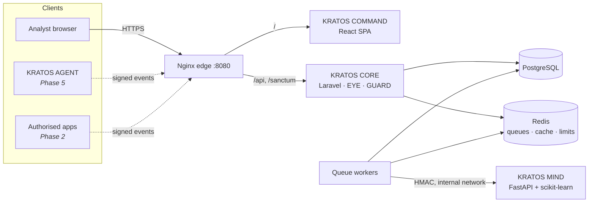

# KRATOS

**Autonomous Threat Intelligence & Cyber Defense Platform**
*Built to Detect. Engineered to Defend.*

KRATOS is a multi-tenant security operations platform: it ingests security
events from systems you control, analyses them with deterministic rules and
machine-learning anomaly detection, correlates them into incidents, and gives
analysts a console to investigate and respond. Any disruptive response needs
a human to approve it.

> **Project status: Phases 1–3 of 6 complete.** Built and tested: authentication,
> RBAC, tenant isolation, audit logging, KRATOS EYE (signed ingestion,
> deduplication, a reliable outbox/queue pipeline, assets, live monitoring) and
> KRATOS MIND (explainable rules, anomaly detection and risk scoring on every
> event). Incidents (GUARD) and agents are designed (see
> [ARCHITECTURE.md](ARCHITECTURE.md)) but not built yet. The dashboard marks
> them as planned rather than showing sample data.

---

## Contents

- [Key features](#key-features)
- [Architecture](#architecture)
- [Technology stack](#technology-stack)
- [Getting started](#getting-started)
- [Development commands](#development-commands)
- [Testing](#testing)
- [Security considerations](#security-considerations)
- [Known limitations](#known-limitations)
- [Troubleshooting](#troubleshooting)
- [Roadmap](#roadmap)

## Key features

Implemented (Phase 3 — KRATOS MIND):

- **Explainable detection on every event**: 10 deterministic rules (brute force,
  credential stuffing, targeted account attack, lockout after failures,
  permission probing, API volume spike, off-hours privileged change, activity
  surge, abnormal timing, critical signatures). Each one reports the value it
  observed and the threshold it compared against.
- **Anomaly detection**: an Isolation Forest calibrated to percentiles, with a
  per-feature explanation of each score. Alongside it runs a robust statistical
  detector per event type, which catches values outside the training range.
- **Risk score (0–100), verdict and threat category** from a documented
  formula, plus a plain-language summary of the main driver.
- **Reproducible training**: a seeded synthetic dataset, and a model card
  (SHA-256, metrics, limitations) that the console labels as a *synthetic
  evaluation*. These numbers are not real-world detection accuracy.
- **Per-organisation rule tuning**: enable or disable rules and adjust
  thresholds within safe bounds. Every change is audited.
- **Threat Intelligence view**: verdicts, anomaly trend, risk distribution,
  rule hits, latest detections and the model card. The event explorer adds
  risk sorting, a verdict filter and the evidence for each event.
- **Resilient to outages**: if MIND is unavailable, events wait and are analysed
  once it returns. This was verified live: nothing was lost or dead-lettered.
- No paid AI API is used, and no event data leaves your deployment.

Implemented (Phase 2 — KRATOS EYE):

- **Signed event ingestion**: HMAC-SHA256 request signatures (no secret on the
  wire), strict schema validation, single and batch endpoints, per-credential
  rate limits, `Idempotency-Key` support and content-fingerprint deduplication.
- **Reliable processing**: transactional outbox → Redis → idempotent worker,
  with exponential-backoff retries, dead-lettering and one-click replay.
  Verified in a live Redis-outage drill: zero events lost.
- **Asset inventory** with automatic `last_seen` and hostname linking.
- **Monitoring dashboard**: per-minute throughput, 24 h severity timeline,
  severity distribution, top event types, pipeline health — all live from the
  API, with table views for every chart.
- **Event explorer** with filters (severity, type, status, asset, time, text),
  severity-ranked sorting and a detail drawer showing pipeline state.
- **`tools/kratos-send`**: dependency-free Python client and synthetic traffic
  simulator.

Implemented (Phase 1):

- **Authentication**: registration, login and logout, email verification,
  password reset, and password change that ends your other sessions. Passwords
  use Argon2id. Login is rate limited, and failed attempts are audited without
  ever storing the password.
- **Session management**: list and revoke your active browser sessions. Raw
  session IDs are never exposed.
- **Personal access tokens**: expiring and ability-scoped (`read`/`write`),
  stored as SHA-256 digests and shown once.
- **RBAC**: Platform Administrator, Organisation Administrator, Security
  Analyst and Read-Only Viewer, enforced server-side. The permission catalogue
  is versioned in code and synchronised to SQL.
- **Tenant isolation in three layers**: route membership checks (non-members
  get `404`), a fail-closed query scope, and policies. Each layer has its own
  tests.
- **Append-only audit log**: the database role used by the application cannot
  `UPDATE` or `DELETE` audit rows.
- **API conventions**: versioned REST API with consistent envelopes, pagination,
  allow-listed sorting and filtering, request IDs, strict security headers and
  an [OpenAPI 3.1 contract](docs/api/openapi.yaml) that a test keeps in sync
  with the routes.
- **KRATOS COMMAND**: dark, responsive SOC console with an overview (live
  health and membership data), organisation settings, member management,
  audit log explorer and account security.

## Architecture



| Component | Responsibility | Status |
| --- | --- | --- |
| **CORE** (Laravel) | Identity, tenancy, RBAC, API, audit, configuration | Implemented |
| **EYE** (Laravel module) | Event ingestion, validation, dedup, assets | Implemented |
| **MIND** (FastAPI) | Detection rules, anomaly detection, risk scoring | Implemented |
| **GUARD** (Laravel module) | Correlation, incidents, human-approved response | Phase 4 |
| **COMMAND** (React) | Security operations console | Implemented (incidents in Phase 4) |
| **AGENT** (Python) | Opt-in host telemetry, heartbeat | Phase 5 |

Full design, including the delivery guarantees (at-least-once with idempotent
consumers; exactly-once is not claimed), is in [ARCHITECTURE.md](ARCHITECTURE.md).
The database design is in [docs/database.md](docs/database.md), and decisions
are recorded in [docs/adr/](docs/adr/).

## Technology stack

| Layer | Technology | Why |
| --- | --- | --- |
| API | PHP 8.4, Laravel 13, Sanctum 4 | Mature auth, policies, queues, migrations; Sanctum covers both SPA cookies and tokens |
| Data | PostgreSQL 17 | Transactions, `jsonb`, partial/functional indexes, role-based privileges |
| Queue / cache | Redis 7.4 | Queue transport, rate limiting, cache |
| Intelligence | Python 3.12+, FastAPI, scikit-learn, pandas, NumPy | Typed internal API and a proven ML toolkit, with no paid AI API required |
| Frontend | React 19, TypeScript, Vite 7, Tailwind CSS 4, TanStack Query, Lucide | Typed SPA, fast tooling, server-state caching |
| Edge | Nginx | Single origin for SPA + API (first-party cookies), security headers |
| Testing | PHPUnit 12, Vitest 3, Testing Library, Playwright | API, component and end-to-end coverage |
| Delivery | Docker Compose, GitHub Actions | Reproducible environment and CI |

## Getting started

### Prerequisites

- Docker Desktop (or Docker Engine) with Compose v2
- Node.js 22+ *(only to run frontend tooling or Playwright on the host)*
- ~4 GB RAM available to Docker

PHP and Composer are **not** required on the host; they run in containers.

### 1. Configure the environment

```bash
cp .env.example .env
```

Replace every `CHANGE_ME` in `.env` with a strong random value, for example
generated with `openssl rand -base64 32`. Never commit `.env`.

### 2. Start the stack

```bash
docker compose up -d --build
```

The one-shot `core-init` service installs PHP dependencies, generates
`APP_KEY`, runs migrations **as the schema-owner role**, and seeds the RBAC
catalogue and the built-in detection rules. On first start the `mind` service
trains its model from the seeded synthetic dataset (about a minute) and keeps it
in the `mind_models` volume. Set `KRATOS_MIND_SHARED_SECRET` in `.env`
(32+ characters); CORE uses it to sign requests to MIND. The application then connects as the least-privilege `kratos_app`
role.

| Service | URL |
| --- | --- |
| KRATOS COMMAND + API | http://localhost:8080 |
| API health | http://localhost:8080/api/v1/health |
| Mailpit (captured email) | http://localhost:8025 |

### 3. Create an account

Open http://localhost:8080/register. The verification email lands in Mailpit;
open it there and follow the link.

### 4. Send security events

In the console, open **Administration → Ingestion Keys**, issue a key, and
copy the key ID and secret (shown once). Then:

```bash
export KRATOS_URL=http://localhost:8080 KRATOS_KEY_ID=krk_... KRATOS_SECRET=krs_...
python tools/kratos-send/kratos_send.py simulate --scenario mixed --count 100 --rate 10
```

Or send your own event (see the schema in [docs/api/openapi.yaml](docs/api/openapi.yaml)):

```bash
echo '{"event_type":"authentication_failure","source":"application_server","severity":"medium","timestamp":"2026-10-23T12:00:00Z","metadata":{"failed_attempts":12,"source_ip":"192.0.2.10"}}' | python tools/kratos-send/kratos_send.py send -
```

Any HTTP client can integrate by signing requests as described in
[ADR-0006](docs/adr/0006-ingestion-credentials.md).

### Demonstration mode (optional)

Set `KRATOS_DEMO_MODE=true` in `.env` and restart `core-init`. This seeds
**clearly labelled synthetic data** — accounts across two tenants
(`*@demo.kratos.test`, `admin@other.kratos.test`), five assets and 24 hours of
synthetic events including a credential-stuffing burst — with a random
password printed once in the `core-init` logs. The console shows a
"Demonstration data" banner for demo organisations. The demo seeder refuses
to run in production.

```bash
docker compose up -d core-init && docker compose logs core-init
```

## Development commands

```bash
# Logs
docker compose logs -f core worker

# Artisan / Composer inside the container
docker compose exec core php artisan route:list --path=api
docker compose exec core composer require vendor/package

# Migrations (always as the schema owner)
docker compose exec core php artisan migrate --database=pgsql_owner
docker compose exec core php artisan migrate:status --database=pgsql_owner

# Re-sync roles and permissions after editing config/kratos.php
docker compose exec core php artisan db:seed --database=pgsql_owner --class=Database\\Seeders\\RbacSeeder

# KRATOS MIND: tests, retrain, re-score recent events with the current model
docker compose exec mind python -m pytest -p no:cacheprovider
docker compose exec mind python -m kratos_mind.training.train --seed 42 --models-dir /srv/mind/models && docker compose restart mind
docker compose exec core php artisan kratos:events:reanalyse --hours=24

# Frontend tooling on the host
cd command && npm install && npm run lint && npm run typecheck
```

Database seeding commands:

| Purpose | Command |
| --- | --- |
| RBAC catalogue (production-safe) | `php artisan db:seed --database=pgsql_owner` |
| Synthetic demo accounts | `php artisan db:seed --database=pgsql_owner --class=Database\\Seeders\\DemoSeeder` |

## Testing

| Suite | Command | What it covers |
| --- | --- | --- |
| API (PHPUnit) | `docker compose run --rm core-init php artisan test` | Auth, RBAC, tenancy, audit, ingestion auth/validation/dedup, outbox and retries, Redis outage, explorer, stats, retention, DB privileges, OpenAPI contract; MIND client signing, analysis pipeline, outage retry, rule tuning, CORE ⇄ MIND contract fixtures |
| CORE ⇄ MIND (real services) | `docker compose exec core php artisan test --testsuite=Integration` | Signed analysis against the running MIND container |
| Intelligence (pytest) | `docker compose exec mind python -m pytest -p no:cacheprovider` | Every rule fires on its scenario and not on normal traffic, model reproducibility and explanations, API authentication (401 before schema validation), shared contracts |
| Code style | `docker compose run --rm core-init vendor/bin/pint --test` | PSR-12 / Laravel style |
| SPA (Vitest) | `cd command && npm test` | API client (CSRF, errors), login flow, permission-aware navigation, intelligence page (synthetic labelling, rule tuning by permission) |
| Ingestion client (Python) | `python -m unittest discover -s tools/kratos-send` | Signature compatibility with the PHP implementation (shared vector), simulator uses documentation IPs only |
| End to end (Playwright) | `cd e2e && npm ci && npx playwright install chromium && npx playwright test` | Register → verify via Mailpit → dashboard; RBAC in the UI; cross-tenant access blocked; issue key → signed ingestion → explorer and overview; brute-force burst → scored malicious by real MIND → explained in the drawer and intelligence view |

API tests run against **real PostgreSQL and Redis** (database `kratos_test`),
not SQLite, so constraints, `jsonb`, functional indexes and role privileges
behave as they do in production. The end-to-end suite needs the full stack
running.

Phase verification results, including the machine they ran on, are recorded
in [docs/phases/](docs/phases/).

## Security considerations

See [SECURITY.md](SECURITY.md) for the threat model, the controls in place
and how to report a vulnerability. In brief:

- Server-side authorisation on every endpoint; the UI only hides controls.
- Tenant isolation in three tested layers; non-members get `404`.
- No secrets in the repository; `.env` is ignored, and all services require passwords.
- Separate DB roles for migrations (owner) and runtime (DML only, append-only audit).
- Only synthetic data is used for demonstrations.
- MIND is reachable only on an internal Docker network, and every request to it is signed. No event data is sent to an external AI provider.

## Known limitations

- **Incidents, reports and agents are not built yet** (Phases 4–5).
- **The detection model is trained and evaluated only on synthetic data**, and
  that data was designed alongside the rules. Its metrics measure internal
  consistency, not real-world detection accuracy. See the model card's
  limitations (`mind/kratos_mind/training/train.py`, shown in the console).
- An Isolation Forest cannot rank values beyond its training range; the
  statistical detector covers this, but novel attack shapes may score low.
- Event list totals use `COUNT(*)`; at very large volumes this needs keyset
  pagination or estimated counts (Phase 6 benchmarking will decide).
- Members can only be added if they already have a verified account; there
  are no email invitations yet.
- No MFA yet (Phase 6 hardening).
- No benchmarks have been run yet. Performance figures will only be published
  once measured (Phase 6).
- No screenshots are included yet.

## Troubleshooting

| Symptom | Fix |
| --- | --- |
| `set KRATOS_… in .env` error on `docker compose up` | Copy `.env.example` to `.env` and set the passwords |
| Port already in use | Change `KRATOS_HTTP_PORT` / `KRATOS_POSTGRES_PORT` / `KRATOS_REDIS_PORT` / `KRATOS_MAILPIT_PORT` in `.env` |
| API responses take several seconds on Windows | Bind mounts from a Windows folder (especially OneDrive-synced ones) are slow. Clone the repo inside the WSL2 filesystem (e.g. `~/src/kratos`) and run Docker from there |
| Frontend edits not showing | The containerised Vite server polls for changes (`VITE_USE_POLLING=true`), because file events don't cross Docker Desktop bind mounts. Allow about a second, or run `docker compose restart command` |
| `419` / CSRF errors in the browser | Use http://localhost:8080 (not :5173), so the SPA and API share an origin |
| No verification email | Check `docker compose logs worker` and the Mailpit UI at http://localhost:8025 |
| Changed DB passwords after first start | Postgres roles are created only on first init. Reset with `docker compose down -v` (**this deletes all local data**) |
| Ingestion returns `401 invalid_signature` | Check the system clock (±300 s), that you sign the exact bytes you send, and that the path is `/api/v1/ingest/events`. Server logs record the precise reason (`eye.ingest.auth_rejected`) |
| Events stuck as `received` | Redis was unavailable; the `outbox-relay` service publishes them automatically once it is back (`docker compose logs outbox-relay`) |
| Events `failed` with "Analysis service unavailable; waiting to retry" | MIND is down or still training. Check `docker compose logs mind`; events are analysed automatically once `/health` reports it up |
| MIND code edits not picked up | Auto-reload is off (slow on bind mounts): `docker compose restart mind` |
| `MissingTenantContext` exception | A tenant-owned model was queried outside a tenant route or job. Set `TenantContext`, or use `withoutTenancy()` deliberately |

## Roadmap

| Phase | Scope | Status |
| --- | --- | --- |
| 1 | Architecture, environment, Laravel API, database, authentication, RBAC, tenancy, React shell | ✅ Complete |
| 2 | Event ingestion API (HMAC credentials, schema validation, idempotency, dedup, outbox), assets, event explorer, monitoring dashboard | ✅ Complete |
| 3 | KRATOS MIND: detection rules, Isolation Forest + statistical anomaly detection, risk scoring, model versioning | ✅ Complete |
| 4 | Incident correlation, investigation timeline, structured reports, human-approved response actions | Planned |
| 5 | KRATOS AGENT, retries/dead-letter visibility, Prometheus metrics, OpenTelemetry | Planned |
| 6 | Benchmarks, MFA, RLS evaluation, hardening, deployment preparation | Planned |

## Repository guide

| Path | Contents |
| --- | --- |
| `core/` | Laravel API (KRATOS CORE) |
| `command/` | React SPA (KRATOS COMMAND) |
| `mind/` | FastAPI intelligence service, training CLI (KRATOS MIND) |
| `contracts/mind/` | Request and rule fixtures shared by the PHP and Python tests |
| `e2e/` | Playwright end-to-end tests |
| `infra/` | Dockerfiles, Nginx, Postgres bootstrap |
| `tools/kratos-send/` | Python ingestion client and traffic simulator |
| `docs/` | ADRs, database design, OpenAPI, phase records |

## License

[MIT](LICENSE)
